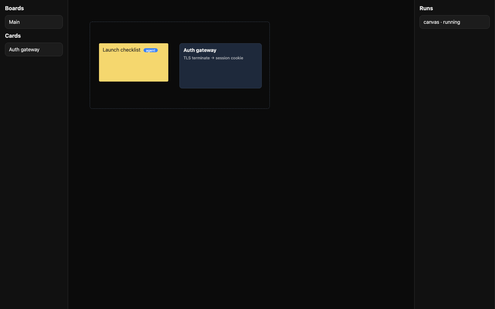

# DSH Buildboard

Language: English | [Русский](README.ru.md)

Heptabase-style whiteboard for DeepSeek Harness: **cards** (project + global), **boards** on [tldraw](https://github.com/tldraw/tldraw), and **agent workflows** (research / implement / `/canvas`) driven by [xstate](https://github.com/statelyai/xstate). The agent edits the same board you see; edits are marked `agent` until you touch them.

## Screenshot



## Features

- **Cards first.** Markdown documents in `<workspace>/.buildboard/cards/` and `$DSH_HOME/buildboard/cards/`. One card can sit on many boards; `[[wiki-links]]` get backlinks.
- **Boards on tldraw.** Infinite canvas with notes, frames, arrows and a custom `card` shape. Multiple boards per project.
- **Agent tools.** `board_*`, `card_*`, `run_report` — surgical edits, live sync.
- **`/canvas <request>`.** Builds a board about the current session (default: explain architecture) and wakes the agent with a structured brief.
- **Research / Implement.** Start a run from the toolbar; progress lives on the run ledger and optional card frontmatter.
- **Fullscreen.** Main-column Buildboard panel plus the right-sidebar tab.
- **Legacy import.** Existing `cult-canvas.canvas` is imported once into board `main`.

## Install

```sh
./scripts/install-dsh-macos.sh
```

Restart the DSH desktop app after installing. `dist/` and `lib/` are committed build output.

tldraw requires a [license key](https://tldraw.dev/community/license) for production. Set `tldrawLicenseKey` in Settings → Plugins → `@local/dsh-buildboard` (hobby/trial/commercial). Local `127.0.0.1` may run without a key in development.

## Usage

### Open

- Start screen / right sidebar: **Buildboard** tab
- Fullscreen: sidebar panel list → Buildboard, or the Fullscreen control on the tab

### `/canvas`

```text
/canvas
/canvas Show the auth flow in this session
```

Creates `session-<id>-…` board, opens it, and `followup`s the agent with the canvas brief.

### Storage

| Path                                          | Contents           |
| --------------------------------------------- | ------------------ |
| `<workspace>/.buildboard/boards/*.board.json` | tldraw record maps |
| `<workspace>/.buildboard/cards/*.md`          | project cards      |
| `$DSH_HOME/buildboard/cards/*.md`             | global cards       |

## Development

```sh
npm install
npm run check   # format, lint, typecheck, unit tests, build:client
```

## Architecture

- `src/domain/` — card, board, run, xstate machines
- `src/application/` — card library, board registry, run service, briefs
- `src/adapters/` — tools, markdown, legacy JSON Canvas
- `src/host/` — Cordis apply, HTTP routes, `/canvas`
- `src/client/` — React tab, panel, tldraw board view, settings

## License

MIT (plugin). tldraw SDK is under the [tldraw license](https://tldraw.dev/community/license).
