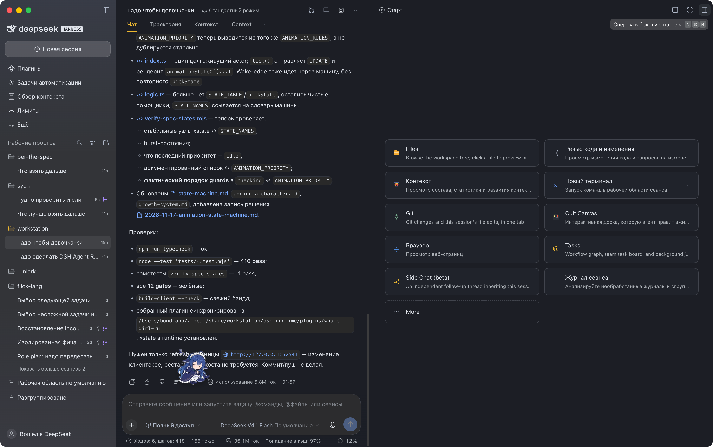
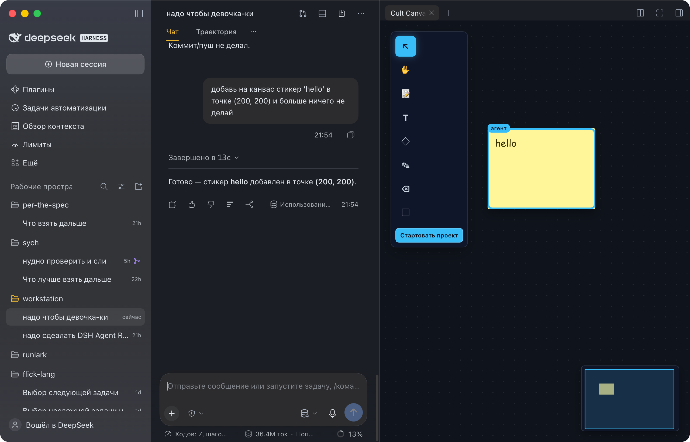

# DSH Cult Canvas

Language: English | [Русский](README.ru.md)

An interactive whiteboard for DeepSeek Harness: sticky notes, shapes, text cards and marker strokes next to a node-based media generation pipeline. The agent works on the same board you do — its edits appear live, marked `agent`, and the board survives restarts as one JSON Canvas file per project.

## Screenshots

| Start screen card                                | Board                                  |
| ------------------------------------------------ | -------------------------------------- |
|  |  |

| Agent edit in place                              | Start project                                          |
| ------------------------------------------------ | ------------------------------------------------------ |
|  |  |

| Settings                                     |
| -------------------------------------------- |
|  |

## Features

- **Start-screen card.** "Cult Canvas" opens the board as a right-sidebar tab; it stays docked next to the conversation while the agent works.
- **Whiteboard.** Sticky notes, 7 geometric shapes with text padding compensation, text cards, freehand marker strokes with an eraser sweep, group frames, marquee selection, Alt+drag duplicate, resize handles and layer ordering.
- **Media pipeline.** DAG nodes for script, storyboard, image, video, audio and finalcut, wired through typed semantic ports (text, image, video, audio, file).
- **Live agent collaboration.** The board you see and the board the agent edits are the same store. Agent edits are outlined and chipped as `agent`; the chip clears when you edit that element yourself.
- **Start a project from the board.** One click writes the board to disk and starts a session whose prompt is a brief generated from what you drew.
- **JSON Canvas 1.0.** The board file is the open `.canvas` format; import and export round-trip through the agent tools.
- **Settings without a restart.** Grid, snapping, element cap and the generation backend live in the plugin's settings page and apply to the open board immediately.

## Install

The plugin ships as a DSH profile bundle. From the workstation repository root:

```sh
./scripts/install-dsh-macos.sh
```

The installer copies the plugin into the DSH runtime and installs its dependencies. `dist/` and `lib/` are committed build output: `dist/` is the TypeScript host half, `lib/client.js` is the browser bundle.

Restart the DSH desktop app after installing; a running process keeps the previous bundle.

## Usage

### Open the board

The **Start** screen shows a **Cult Canvas** card. Picking it opens the board in the right sidebar. The board is per project: the session's workspace decides which file you see.

### Draw

| Tool   | Key | What it does                                  |
| ------ | --- | --------------------------------------------- |
| Select | `V` | Move, resize and marquee-select               |
| Hand   | `H` | Pan; the wheel pans, `Ctrl`/`⌘` + wheel zooms |
| Sticky | `S` | Place a sticky note with a colour palette     |
| Text   | `T` | Place a borderless text card                  |
| Shape  | `R` | Place one of 7 shapes                         |
| Marker | `P` | Draw a freehand stroke                        |
| Eraser | `E` | Sweep across strokes to delete them           |
| Frame  | `F` | Place a group frame                           |

`]`/`[` reorder layers, `Delete` removes the selection, `Alt`+drag duplicates.

### Start a project from the board

**Start project** (bottom of the toolbar) does three things in order:

1. Posts the board's pending edits to the Host.
2. Asks the Host to write `<workspace>/cult-canvas.canvas` immediately.
3. Starts a session in that workspace with a brief built from the board.

The brief is deterministic — the same board always produces the same text:

```text
Cult Canvas project brief
Board: /home/me/film
Contents: 3 elements (sticky=2, shape=1); 1 edges

Elements:
- sticky "launch checklist" @ (40, 80)
- sticky "titles" @ (40, 320)
- shape "Storyboard" @ (400, 80)

Work with this board through the cult-canvas tools: canvas_get_state first, then
canvas_create_element, canvas_update_element, canvas_delete_element and canvas_connect
for targeted changes.
Your edits show up live in the user's open board and are marked as agent edits.
The board is stored at <workspace>/cult-canvas.canvas and is saved automatically.
```

The button appears only when the shell can start a session; without that service the board still works.

### Agent collaboration

The agent reaches the board through twelve tools:

| Tool                     | Purpose                                                |
| ------------------------ | ------------------------------------------------------ |
| `canvas_get_state`       | Read elements, edges, bounds and the series bible      |
| `canvas_query_elements`  | Filter by kind, type or area                           |
| `canvas_create_element`  | Add a sticky, shape, text card or pipeline node        |
| `canvas_update_element`  | Patch text, position, size, colour or media parameters |
| `canvas_delete_element`  | Delete elements and their incident edges               |
| `canvas_connect`         | Wire two nodes through typed ports                     |
| `canvas_layout_elements` | Place or auto-layout a set of elements                 |
| `canvas_run_pipeline`    | Execute one node (`step`) or a workflow (`all`)        |
| `canvas_node_status`     | Report progress, status and errors of a node           |
| `canvas_import_export`   | Round-trip JSON Canvas 1.0                             |
| `canvas_get_bible`       | Read the series bible                                  |
| `canvas_update_bible`    | Merge worldview, style, characters, scenes, props      |

Example dialogue:

> **You:** add a sticky note "launch checklist" left of the storyboard
>
> **Agent:** _calls `canvas_get_state` to find the storyboard's position, then `canvas_create_element` with `kind: "sticky"`, `text: "launch checklist"` and coordinates to its left_

The note appears on your open board outlined and chipped as `agent` within a couple of seconds; editing the note yourself clears the chip.

### Worked example: a shot breakdown

> **You:** I have a 15-second teaser. Set up the board.
>
> **Agent:** `canvas_get_state` → the board is empty → `canvas_create_element` `kind: "script"` with the teaser premise → `canvas_create_element` `kind: "storyboard"` next to it → `canvas_connect` from the script's `text` port to the storyboard's `text` port → `canvas_create_element` `kind: "image"` for the hero shot, wired from the storyboard.

The board then holds three nodes, two connectors, and the shot list inside the storyboard card. Running the image node (`canvas_run_pipeline`, `mode: "step"`) writes an asset id back onto the node.

### Worked example: editing an existing board

> **You:** the second sticky in the "titles" frame should be red and say "end card"
>
> **Agent:** `canvas_query_elements` with `kind: "sticky"` → finds the candidates and their coordinates → `canvas_update_element` with `{ color: "#FF8A80", text: "end card" }` on the one inside the frame.

Both changes land as one stamped edit, so a reload keeps them and your own later edit takes over the `agent` badge.

### Media pipeline providers

`canvas_run_pipeline` drives the backend named in the settings:

| Provider | What it calls                               | Needs                                            |
| -------- | ------------------------------------------- | ------------------------------------------------ |
| `mock`   | Deterministic offline generator             | nothing                                          |
| `openai` | OpenAI-compatible images and speech         | `generationApiKey`, optional `generationBaseUrl` |
| `wanx`   | Alibaba DashScope Wanx (asynchronous video) | `generationApiKey`, optional `generationBaseUrl` |

Example: set `generationProvider` to `openai`, paste the key into `generationApiKey`, then ask the agent to run an image node. With the key left empty the provider falls back to `OPENAI_API_KEY` in the Host environment.

## Settings

**Settings → Plugins → `@local/dsh-cult-canvas`**. Every value applies without a restart.

| Key                   | Type                         | Default | Meaning                                                        |
| --------------------- | ---------------------------- | ------- | -------------------------------------------------------------- |
| `defaultCanvasWidth`  | integer (100–100000)         | `8192`  | Board width when a document carries none                       |
| `defaultCanvasHeight` | integer (100–100000)         | `8192`  | Board height when a document carries none                      |
| `maxElements`         | integer (1–50000)            | `5000`  | Element cap of one board; the store refuses the create past it |
| `snapToGrid`          | boolean                      | `true`  | Snap drags and resizes to the grid                             |
| `gridSize`            | integer (1–500)              | `20`    | Grid step in world units                                       |
| `generationProvider`  | `mock` \| `openai` \| `wanx` | `mock`  | Media generation backend                                       |
| `generationApiKey`    | string                       | empty   | Key for the selected backend                                   |
| `generationBaseUrl`   | string                       | empty   | Base URL override for the selected backend                     |

The API key is stored in your user settings document (outside Git), masked in the form, and never written into the board file.

## Files

- `<workspace>/cult-canvas.canvas` — the board, JSON Canvas 1.0, written atomically after each change (2 s debounce) and immediately on **Start project**.
- Sessions without a workspace share one in-memory board; it is not persisted.

Actor stamps (`updatedBy`, `updatedAt`) travel in the node's `styleAttributes` as `gbUpdatedBy`/`gbUpdatedAt`, because JSON Canvas 1.0 has no top-level slot for them.

## Development

```sh
npm install
npm run check   # format:check, lint, typecheck, tests, build:client
```

`npm run check` is the whole gate: `tsc` produces `dist/`, `tsdown` produces `lib/client.js`, and `node --test` runs unit and end-to-end suites. Commit both build outputs.

## Architecture

- `src/domain/` — element, connector, pipeline and JSON Canvas types; element factories; geometry; the xstate machines.
- `src/application/` — `CanvasStore` (revisioned store), `BoardRegistry` (one board per workspace, autosave), `board-sync` (last-writer-wins merge), `project-brief`, `graph-engine`, `pipeline-engine`.
- `src/adapters/` — the twelve agent tools, the JSON Canvas adapter, locale dictionaries.
- `src/infrastructure/` — generation providers (mock, OpenAI, Wanx), task poller, authenticated web-route wrapper.
- `src/presentation/` — Host entrypoint and web route; client shell, tab body, settings card and whiteboard components.

## License

MIT
