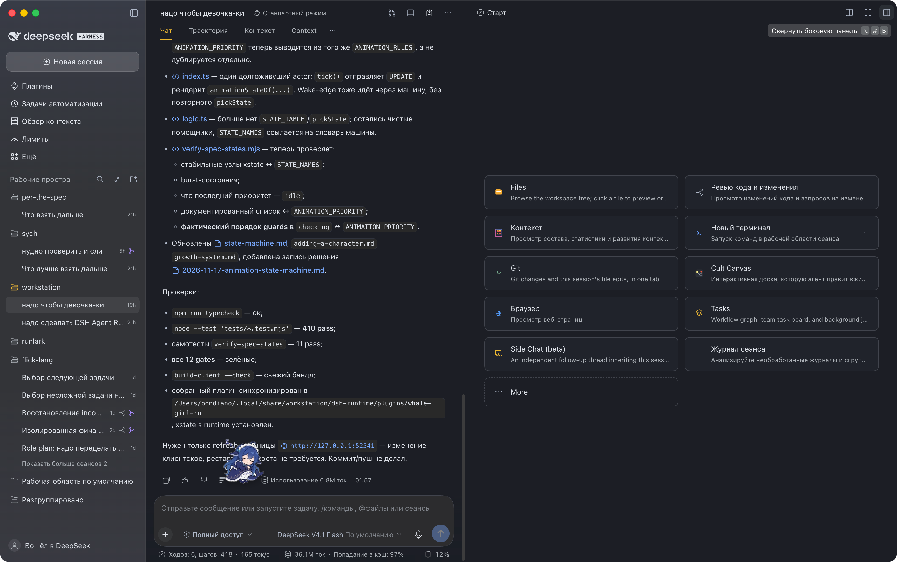
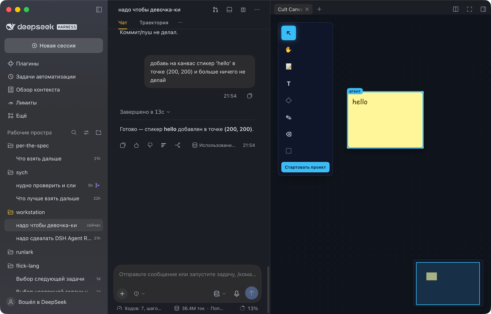
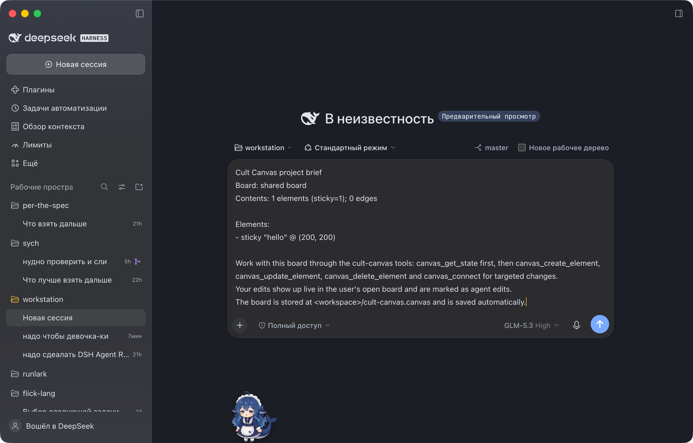

# DSH Cult Canvas

Язык: [English](README.md) | Русский

Интерактивная доска для DeepSeek Harness: стикеры, фигуры, текстовые карточки и росчерки маркера рядом с узловым пайплайном генерации медиа. Агент работает на той же доске, что и вы: его правки появляются вживую с меткой `agent`, а сама доска переживает перезапуск как один файл JSON Canvas на проект.

## Скриншоты

| Карточка на «Старт»                            | Доска                                  |
| ---------------------------------------------- | -------------------------------------- |
|  |  |

| Правка агента на месте                              | Старт проекта                                          |
| --------------------------------------------------- | ------------------------------------------------------ |
|  |  |

## Возможности

- **Карточка на «Старт».** «Cult Canvas» открывает доску вкладкой в правом сайдбаре: она остаётся рядом с диалогом, пока работает агент.
- **Доска.** Стикеры, 7 геометрических фигур с компенсацией отступов текста, текстовые карточки, росчерки маркера с ластиком-развёрткой, рамки-группы, выделение рамкой, дублирование `Alt`+drag, ручки ресайза и порядок слоёв.
- **Пайплайн медиа.** Узлы script, storyboard, image, video, audio и finalcut, соединённые типизированными портами (text, image, video, audio, file).
- **Живая работа с агентом.** Доска на экране и доска, которую правит агент, — одно хранилище. Правки агента обведены и помечены чипом `agent`; чип снимается, когда вы сами правите этот элемент.
- **Старт проекта с доски.** Один клик записывает доску на диск и открывает сессию, промпт которой — бриф, собранный из нарисованного.
- **JSON Canvas 1.0.** Файл доски — открытый формат `.canvas`; импорт и экспорт идут через инструменты агента.
- **Настройки без перезапуска.** Сетка, привязка, лимит элементов и провайдер генерации живут на странице настроек плагина и применяются к открытой доске сразу.

## Установка

Плагин ставится как бандл профиля DSH. Из корня репозитория workstation:

```sh
./scripts/install-dsh-macos.sh
```

Установщик копирует плагин в рантайм DSH и ставит зависимости. `dist/` и `lib/` — закоммиченный результат сборки: `dist/` — host-половина на TypeScript, `lib/client.js` — бандл браузера.

После установки перезапустите приложение DSH: живой процесс держит прежний бандл.

## Использование

### Открыть доску

На экране **Старт** есть карточка **Cult Canvas**. Она открывает доску в правом сайдбаре. Доска — per-project: рабочая папка сессии решает, какой файл вы видите.

### Рисование

| Инструмент | Клавиша | Что делает                                                      |
| ---------- | ------- | --------------------------------------------------------------- |
| Select     | `V`     | Двигать, ресайзить, выделять рамкой                             |
| Hand       | `H`     | Панорама; колесо панорамирует, `Ctrl`/`⌘` + колесо масштабирует |
| Sticky     | `S`     | Поставить стикер с палитрой цветов                              |
| Text       | `T`     | Поставить текстовую карточку без рамки                          |
| Shape      | `R`     | Поставить одну из 7 фигур                                       |
| Marker     | `P`     | Нарисовать росчерк                                              |
| Eraser     | `E`     | Провести по росчеркам, чтобы удалить их                         |
| Frame      | `F`     | Поставить рамку-группу                                          |

`]`/`[` меняют порядок слоёв, `Delete` удаляет выделение, `Alt`+drag дублирует.

### Старт проекта с доски

Кнопка **Стартовать проект** (внизу панели инструментов) делает три вещи по порядку:

1. Отправляет на Host ещё не сохранённые правки доски.
2. Просит Host немедленно записать `<workspace>/cult-canvas.canvas`.
3. Открывает сессию в этой папке с брифом, собранным из доски.

Бриф детерминирован — одна и та же доска всегда даёт один и тот же текст:

```text
Cult Canvas project brief
Board: /home/me/film
Contents: 3 elements (sticky=2, shape=1); 1 edges

Elements:
- sticky "launch checklist" @ (40, 80)
- sticky "titles" @ (40, 320)
- shape "Storyboard" @ (400, 80)

Work with this board through the cult-canvas tools: canvas_get_state first, then
canvas_create_element, canvas_update_element, canvas_delete_element and canvas_connect
for targeted changes.
Your edits show up live in the user's open board and are marked as agent edits.
The board is stored at <workspace>/cult-canvas.canvas and is saved automatically.
```

Кнопка появляется только когда оболочка умеет стартовать сессию; без этого сервиса доска продолжает работать.

### Работа с агентом

Агент достаёт доску двенадцатью инструментами:

| Инструмент               | Назначение                                                     |
| ------------------------ | -------------------------------------------------------------- |
| `canvas_get_state`       | Прочитать элементы, рёбра, границы и библию сериала            |
| `canvas_query_elements`  | Фильтр по виду, типу или области                               |
| `canvas_create_element`  | Добавить стикер, фигуру, текстовую карточку или узел пайплайна |
| `canvas_update_element`  | Изменить текст, позицию, размер, цвет или параметры медиа      |
| `canvas_delete_element`  | Удалить элементы и их рёбра                                    |
| `canvas_connect`         | Соединить два узла типизированными портами                     |
| `canvas_layout_elements` | Расставить или авторазложить набор элементов                   |
| `canvas_run_pipeline`    | Выполнить узел (`step`) или весь workflow (`all`)              |
| `canvas_node_status`     | Показать прогресс, статус и ошибки узла                        |
| `canvas_import_export`   | Двусторонний JSON Canvas 1.0                                   |
| `canvas_get_bible`       | Прочитать библию сериала                                       |
| `canvas_update_bible`    | Слить worldview, style, characters, scenes, props              |

Пример диалога:

> **Вы:** добавь стикер «launch checklist» слева от раскадровки
>
> **Агент:** _зовёт `canvas_get_state`, чтобы найти позицию раскадровки, затем `canvas_create_element` с `kind: "sticky"`, `text: "launch checklist"` и координатами слева от неё_

Стикер появляется на открытой доске обведённым и с чипом `agent` за пару секунд; правите стикер сами — чип исчезает.

### Пример: раскадровка ролика

> **Вы:** у меня 15-секундный тизер. Разложи доску.
>
> **Агент:** `canvas_get_state` → доска пуста → `canvas_create_element` `kind: "script"` с завязкой тизера → `canvas_create_element` `kind: "storyboard"` рядом → `canvas_connect` из порта `text` сценария в порт `text` раскадровки → `canvas_create_element` `kind: "image"` для главного кадра, соединённый с раскадровкой.

На доске три узла, две связи и список кадров внутри карточки раскадровки. Запуск узла изображения (`canvas_run_pipeline`, `mode: "step"`) записывает id ассета обратно в узел.

### Пример: правка существующей доски

> **Вы:** второй стикер в рамке «titles» должен быть красным и говорить «end card»
>
> **Агент:** `canvas_query_elements` с `kind: "sticky"` → находит кандидатов и их координаты → `canvas_update_element` с `{ color: "#FF8A80", text: "end card" }` на том, что внутри рамки.

Обе правки приходят одной помеченной записью: перезагрузка их сохраняет, а ваша следующая правка забирает метку `agent` себе.

### Провайдеры генерации

`canvas_run_pipeline` работает с бэкендом из настроек:

| Провайдер | Что вызывает                               | Что нужно                                                 |
| --------- | ------------------------------------------ | --------------------------------------------------------- |
| `mock`    | Детерминированный офлайн-генератор         | ничего                                                    |
| `openai`  | OpenAI-совместимые изображения и речь      | `generationApiKey`, при необходимости `generationBaseUrl` |
| `wanx`    | Alibaba DashScope Wanx (асинхронное видео) | `generationApiKey`, при необходимости `generationBaseUrl` |

Пример: поставьте `generationProvider` в `openai`, вставьте ключ в `generationApiKey`, попросите агента запустить узел изображения. Если ключ пуст, провайдер берёт `OPENAI_API_KEY` из окружения Host.

## Настройки

**Настройки → Плагины → `@local/dsh-cult-canvas`**. Каждое значение применяется без перезапуска.

| Ключ                  | Тип                          | По умолчанию | Что значит                                               |
| --------------------- | ---------------------------- | ------------ | -------------------------------------------------------- |
| `defaultCanvasWidth`  | целое (100–100000)           | `8192`       | Ширина доски, когда документ её не задаёт                |
| `defaultCanvasHeight` | целое (100–100000)           | `8192`       | Высота доски, когда документ её не задаёт                |
| `maxElements`         | целое (1–50000)              | `5000`       | Лимит элементов одной доски; сверх него store отказывает |
| `snapToGrid`          | boolean                      | `true`       | Привязывать перетаскивание и ресайз к сетке              |
| `gridSize`            | целое (1–500)                | `20`         | Шаг сетки в мировых единицах                             |
| `generationProvider`  | `mock` \| `openai` \| `wanx` | `mock`       | Бэкенд генерации медиа                                   |
| `generationApiKey`    | строка                       | пусто        | Ключ выбранного бэкенда                                  |
| `generationBaseUrl`   | строка                       | пусто        | Переопределение базового URL                             |

API-ключ хранится в вашем пользовательском документе настроек (вне Git), маскируется в форме и никогда не попадает в файл доски.

## Файлы

- `<workspace>/cult-canvas.canvas` — доска, JSON Canvas 1.0, пишется атомарно после каждой правки (задержка 2 с) и сразу по кнопке **Стартовать проект**.
- Сессии без рабочей папки делят одну доску в памяти; она не сохраняется.

Метки актора (`updatedBy`, `updatedAt`) едут в `styleAttributes` узла как `gbUpdatedBy`/`gbUpdatedAt`: в JSON Canvas 1.0 для них нет поля верхнего уровня.

## Разработка

```sh
npm install
npm run check   # format:check, lint, typecheck, тесты, build:client
```

`npm run check` — весь гейт: `tsc` собирает `dist/`, `tsdown` собирает `lib/client.js`, `node --test` гоняет юнит- и e2e-наборы. Коммитьте оба результата сборки.

## Архитектура

- `src/domain/` — типы элементов, связей, пайплайна и JSON Canvas; фабрики элементов; геометрия; машины xstate.
- `src/application/` — `CanvasStore` (хранилище с ревизией), `BoardRegistry` (одна доска на workspace, автосейв), `board-sync` (слияние last-writer-wins), `project-brief`, `graph-engine`, `pipeline-engine`.
- `src/adapters/` — двенадцать инструментов агента, адаптер JSON Canvas, словари локалей.
- `src/infrastructure/` — провайдеры генерации (mock, OpenAI, Wanx), опрос задач, обёртка аутентифицированного веб-роута.
- `src/presentation/` — host-энтрипоинт и веб-роут; клиентская оболочка, тело вкладки, карточка настроек и компоненты доски.

## Лицензия

MIT
